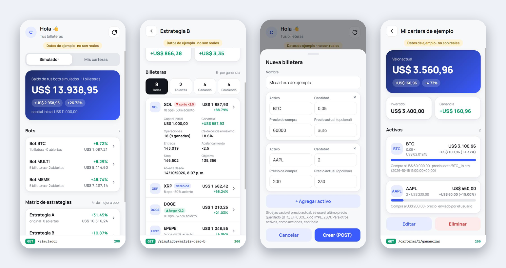
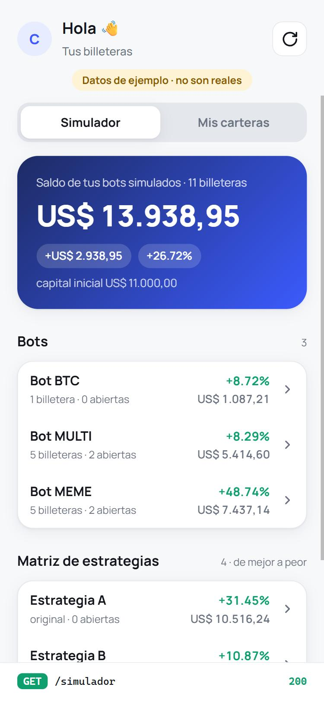
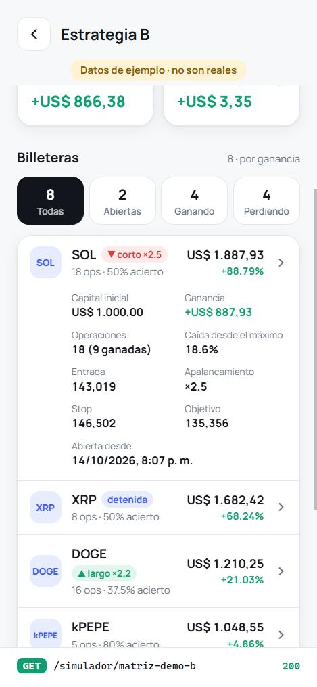
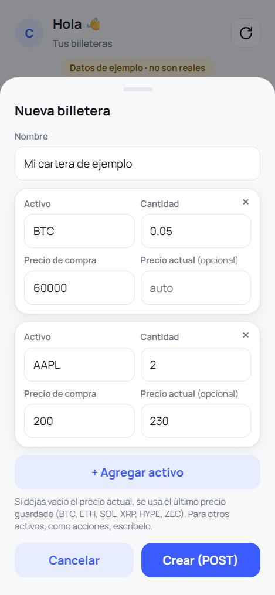
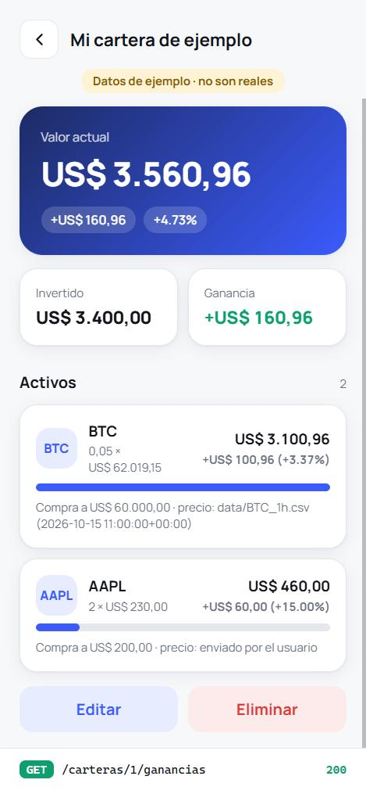
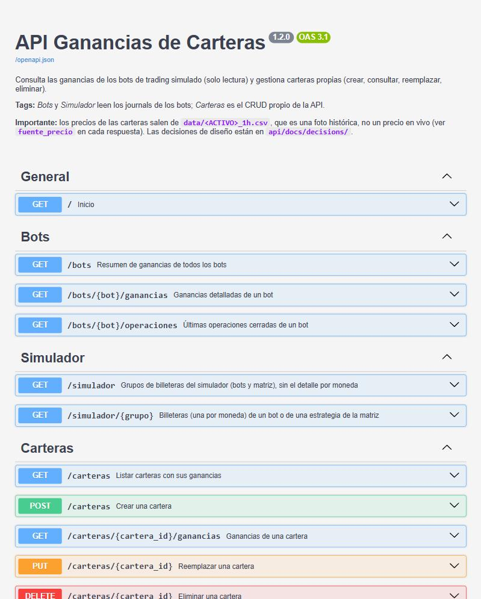
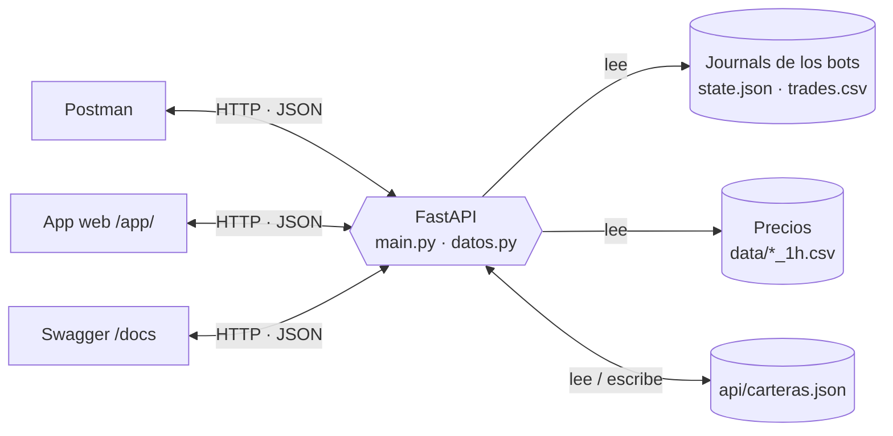

<div align="center">

# 📈 API Ganancias de Carteras

**Consulta las ganancias de tus bots de trading simulado y gestiona tus propias carteras.**
Una API REST con FastAPI, una app web con aspecto de celular y una colección de Postman.




</div>

---

## ✨ ¿Qué hace?

La API tiene dos funciones:

| | Función | Cómo |
|---|---|---|
| 🤖 | **Consultar las billeteras del simulador** | Lee los archivos que escriben los bots de *paper trading* y devuelve saldo, ganancia, rentabilidad, operaciones y posición abierta de cada billetera. **Solo lectura.** |
| 💼 | **Gestionar carteras propias** | Creas, consultas, reemplazas y eliminas carteras (GET, POST, PUT, DELETE). La API calcula la ganancia de cada posición y del total. |

> Una **billetera** es el libro de una moneda dentro de un bot o estrategia, con su propio capital.
> Este repositorio **no contiene el código de ningún bot**: solo la API y los datos de ejemplo para probarla.

**Contenido:** [Inicio rápido](#-inicio-rápido) · [La app](#-la-app-web) · [Endpoints](#-endpoints) ·
[Ejemplos](#-ejemplos) · [Arquitectura](#-arquitectura) · [Datos](#-datos-de-ejemplo-y-datos-propios) ·
[Postman](#-postman) · [Pruebas](#-pruebas) · [Decisiones](#-decisiones-de-diseño) · [Estructura](#-estructura-del-repositorio)

---

## 🚀 Inicio rápido

Necesitas **Python 3.10 o superior**.

```bash
git clone <URL-DEL-REPOSITORIO>
cd api-ganancias-carteras
pip install -r api/requirements.txt
python api/main.py
```

Listo. Sin configurar nada, la API arranca con los [datos de ejemplo](#-datos-de-ejemplo-y-datos-propios).

| Qué | Dónde |
|---|---|
| 📱 App web | http://127.0.0.1:8000/app/ |
| 📚 Documentación interactiva (Swagger) | http://127.0.0.1:8000/docs |
| 🧾 Esquema OpenAPI | http://127.0.0.1:8000/openapi.json |
| 🔌 API | http://127.0.0.1:8000 |

Para usar otro puerto, define la variable `PORT` antes de arrancar (por defecto 8000). Se detiene con `Ctrl + C`.

---

## 📱 La app web

`/app/` es una página con aspecto de celular (HTML y JavaScript, sin librerías ni compilación) que usa la misma API.
Cuando trabaja con los datos de ejemplo muestra una etiqueta amarilla fija. Su **barra inferior muestra la última
petición HTTP enviada** (método, ruta y estado), así cada pantalla deja ver qué operación usa.

<table>
  <tr>
    <td align="center" width="25%"></td>
    <td align="center" width="25%"></td>
    <td align="center" width="25%"></td>
    <td align="center" width="25%"></td>
  </tr>
  <tr>
    <td align="center"><b>Simulador</b><br>Bots y estrategias<br><code>GET /simulador</code></td>
    <td align="center"><b>Billeteras</b><br>Filtros y detalle al tocar<br><code>GET /simulador/{grupo}</code></td>
    <td align="center"><b>Crear cartera</b><br><code>POST /carteras</code></td>
    <td align="center"><b>Mi cartera</b><br>Editar (<code>PUT</code>) y eliminar (<code>DELETE</code>)</td>
  </tr>
</table>

### 📚 Documentación interactiva

FastAPI genera `/docs` (Swagger) a partir del código: lista cada ruta con su descripción y códigos de respuesta,
y permite probarlas desde el navegador.

<p align="center"></p>

---

## 🔌 Endpoints

| Método | Ruta | Respuesta | Qué hace |
|---|---|---|---|
| GET | `/bots` | 200 | Resumen de ganancias de los bots `btc`, `multi` y `meme` |
| GET | `/bots/{bot}/ganancias` | 200, 404 | Tasa de acierto, PnL, comisiones y resultado por moneda (`?moneda=ETH` para filtrar) |
| GET | `/bots/{bot}/operaciones` | 200, 404, 422 | Últimas operaciones cerradas (`?limite=10`, de 1 a 500) |
| GET | `/simulador` | 200 | Todos los grupos del simulador: bots y estrategias de la matriz |
| GET | `/simulador/{grupo}` | 200, 404 | Una billetera por moneda de un bot o estrategia |
| GET | `/carteras` | 200 | Tus carteras con sus ganancias |
| GET | `/carteras/{id}/ganancias` | 200, 404 | Ganancia de una cartera, posición por posición |
| **POST** | `/carteras` | **201**, 422 | Crea una cartera |
| **PUT** | `/carteras/{id}` | **200**, 404, 422 | Reemplaza por completo nombre y posiciones |
| **DELETE** | `/carteras/{id}` | **204**, 404 | Elimina la cartera |

Referencia completa, con todos los campos, errores y el formato de los datos: **[docs/API.md](docs/API.md)**.

---

## 🧪 Ejemplos

### Crear una cartera (`POST /carteras`)

```bash
curl -X POST http://127.0.0.1:8000/carteras -H "Content-Type: application/json" -d '{
  "nombre": "Mi cartera",
  "posiciones": [
    { "activo": "BTC",  "cantidad": 0.05, "precio_compra": 60000 },
    { "activo": "AAPL", "cantidad": 2,    "precio_compra": 200, "precio_actual": 230 }
  ]
}'
```

Responde `201 Created`. La ganancia de cada posición es `cantidad × (precio actual − precio de compra)`:

```json
{
  "id": 1,
  "nombre": "Mi cartera",
  "total_invertido": 3400.0,
  "valor_actual": 3560.96,
  "ganancia_total": 160.96,
  "rentabilidad_pct": 4.73,
  "posiciones": [
    {
      "activo": "BTC", "cantidad": 0.05, "precio_compra": 60000.0, "precio_actual": 62019.152696,
      "fuente_precio": "data/BTC_1h.csv (2026-10-15 11:00:00+00:00)",
      "invertido": 3000.0, "valor_actual": 3100.96, "ganancia": 100.96, "rentabilidad_pct": 3.37
    },
    {
      "activo": "AAPL", "cantidad": 2.0, "precio_compra": 200.0, "precio_actual": 230.0,
      "fuente_precio": "enviado por el usuario",
      "invertido": 400.0, "valor_actual": 460.0, "ganancia": 60.0, "rentabilidad_pct": 15.0
    }
  ]
}
```

> 💡 Si no envías `precio_actual`, la API usa la última vela guardada en `data/<ACTIVO>_1h.csv` y lo indica en
> `fuente_precio`. Para activos sin archivo de precios (por ejemplo acciones), envíalo tú.

### Consultar las billeteras de un bot (`GET /simulador/multi`)

```bash
curl http://127.0.0.1:8000/simulador/multi
```

<details>
<summary>Ver la respuesta (recortada a una billetera)</summary>

```json
{
  "id": "multi", "titulo": "Bot MULTI", "tipo": "bot",
  "capital_inicial": 5000.0, "equity": 5423.71,
  "ganancia_realizada": 423.71, "ganancia_no_realizada": -9.11,
  "ganancia_total": 414.6, "rentabilidad_pct": 8.29,
  "num_billeteras": 5, "posiciones_abiertas": 2,
  "billeteras": [
    {
      "moneda": "XRP", "capital_inicial": 1000.0, "equity": 1189.88, "ganancia": 189.88,
      "rentabilidad_pct": 18.99, "operaciones": 6, "ganadas": 3, "tasa_acierto_pct": 50.0,
      "caida_desde_maximo_pct": 0.0, "detenida": false, "motivo_detencion": null,
      "posicion": {
        "lado": "largo", "precio_entrada": 0.49625975, "stop": 0.48492294, "objetivo": 0.52120074,
        "apalancamiento": 2.6, "nocional": 3125.16, "abierta_desde": "2026-10-14T19:12:37.128685+00:00"
      }
    }
  ]
}
```

</details>

### Errores claros

| Situación | Respuesta |
|---|---|
| `GET /carteras/99/ganancias` | `404` · `{"detail": "Cartera 99 no encontrada"}` |
| `POST` con `cantidad: -1` | `422` · `Input should be greater than 0` (indica el campo) |
| `POST` con un activo sin precio (`FOO`) | `422` · `No hay precio para 'FOO'. Envía 'precio_actual' o usa uno de [...]` |

---

## 🧭 Arquitectura



- **Los journals de los bots son de solo lectura.** La API no importa código de los bots ni escribe en sus carpetas.
- **Lo único que la API escribe** es `api/carteras.json`, con las carteras del usuario.
- Los motivos de cada decisión están en los [registros de decisiones](#-decisiones-de-diseño).

---

## 🗂️ Datos de ejemplo y datos propios

Los bots reales **no forman parte de este repositorio**. Para que cualquiera pueda ejecutar la API, se incluye
[`demo-data/`](demo-data): datos **inventados** con el mismo formato que los reales
(3 bots y 4 estrategias de ejemplo, más precios ficticios). Se generan con `python tools/generar_datos_demo.py`.

La API decide de dónde leer, en este orden:

1. La variable de entorno **`SIMULADOR_DIR`**, si está definida (tus datos).
2. La carpeta padre de `api/`, si ya contiene los journals de los bots.
3. **`demo-data/`** (el caso de quien acaba de clonar el repositorio).

Para apuntar a tus propios datos:

```bash
# Linux / macOS
SIMULADOR_DIR=/ruta/a/tus/datos python api/main.py
```

```powershell
# Windows (PowerShell)
$env:SIMULADOR_DIR = "C:\ruta\a\tus\datos"; python api/main.py
```

El formato de las carpetas y archivos que espera la API está descrito en
[docs/API.md](docs/API.md#formato-de-los-datos-del-simulador).

---

## 📮 Postman

1. Arranca el servidor (`python api/main.py`).
2. En Postman: **Import** → selecciona [`api/postman_collection.json`](api/postman_collection.json).
3. Ejecuta las peticiones en orden: **GET → POST → PUT → DELETE**.

El POST guarda el `id` creado en la variable `cartera_id`, y el PUT y el DELETE actúan sobre esa cartera.
La variable `base_url` vale `http://127.0.0.1:8000`; cámbiala si usas otro puerto.

> ⚠️ Si ejecutas la colección completa con *Run collection*, termina con el DELETE y no queda ninguna cartera.
> Para dejarla guardada, envía solo el POST.

Con la app de **Postman web** hay que instalar el *Desktop Agent*; la app de escritorio funciona sin nada extra.

---

## ✅ Pruebas

```bash
pip install pytest
pytest
```

Las pruebas usan los datos de ejemplo y un archivo de carteras temporal, así que no tocan tus datos.
Comprueban el CRUD completo, el cálculo de ganancias, las validaciones (`422`), los `404` y los endpoints del simulador.

---

## 🧱 Decisiones de diseño

Cada decisión importante tiene su registro (ADR) con contexto, alternativas y consecuencias:

| ADR | Decisión |
|---|---|
| [001](api/docs/decisions/ADR-001-fastapi-como-framework.md) | FastAPI como framework |
| [002](api/docs/decisions/ADR-002-carteras-en-archivo-json.md) | Carteras guardadas en un archivo JSON |
| [003](api/docs/decisions/ADR-003-journals-de-bots-solo-lectura.md) | Journals de los bots en solo lectura |
| [004](api/docs/decisions/ADR-004-precios-desde-csv-locales.md) | Precios desde los CSV locales |
| [005](api/docs/decisions/ADR-005-interfaz-web-servida-por-la-api.md) | Interfaz web servida por la misma API |

---

## 📁 Estructura del repositorio

```
.
├── api/
│   ├── main.py                  Rutas, validación de entrada y cálculo de ganancias
│   ├── datos.py                 Lectura de datos (solo lectura), precios y guardado de carteras
│   ├── static/index.html        App web
│   ├── postman_collection.json  Colección de Postman
│   ├── requirements.txt
│   ├── CHANGELOG.md
│   └── docs/decisions/          Registros de decisiones (ADR)
├── demo-data/                   Datos de ejemplo inventados (journals, matriz y precios)
├── docs/
│   ├── API.md                   Referencia completa de la API
│   └── img/                     Capturas
├── tests/test_api.py            Pruebas automáticas
└── tools/generar_datos_demo.py  Generador de los datos de ejemplo
```

---

## ⚠️ Limitaciones conocidas

- **Pensada para un solo usuario:** `carteras.json` no tiene bloqueo de archivo y la API no tiene autenticación.
  Escucha solo en `127.0.0.1`, así que solo es accesible desde tu equipo.
- **Los precios de las carteras no son en vivo:** salen del último dato guardado en `data/<ACTIVO>_1h.csv`.
- **Las posiciones abiertas no se valoran por moneda:** su ganancia solo aparece sumada por grupo.
- **Es una herramienta de consulta sobre datos simulados.** No ejecuta operaciones ni da consejos de inversión.
